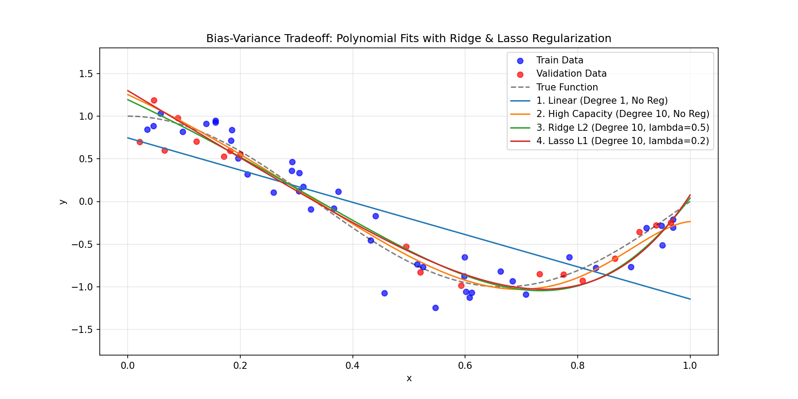

# Project 02: Regularization, Polynomial Features & Overfitting Diagnostics

A from-scratch NumPy implementation of **Polynomial Feature Expansion**, **$Z$-Score Standardization (without data leakage)**, **L2 (Ridge)** and **L1 (Lasso) Regularization**, and **Bias-Variance Diagnostics**.

---

## 🎯 Concepts Mastered

1. **Polynomial Feature Expansion**:
   - Transforming non-linear data into higher dimensional feature spaces $[x^1, x^2, \dots, x^d]$ using clean vectorization (`np.hstack`).
2. **Preventing Data Leakage with $Z$-Score Standardization**:
   - Why high polynomial degrees cause gradient divergence without scaling.
   - Strictly fitting mean $\mu_{\text{train}}$ and std $\sigma_{\text{train}}$ on training data and reusing them on validation data (`axis=0` with $\epsilon$-guardrail).
3. **L2 (Ridge) Regularization (Weight Decay)**:
   - Penalty: $J = \text{MSE} + \frac{\lambda}{2m} \sum w_j^2$
   - Gradient: $\frac{\partial J}{\partial w} = \frac{1}{m} X^T (\hat{y} - y) + \frac{\lambda}{m} w$
   - Proportional weight decay smoothing out steep fluctuations without setting weights strictly to zero.
4. **L1 (Lasso) Regularization (Feature Selection & Sparsity)**:
   - Penalty: $J = \text{MSE} + \frac{\lambda}{m} \sum |w_j|$
   - Sub-gradient: $\frac{\partial J}{\partial w} = \frac{1}{m} X^T (\hat{y} - y) + \frac{\lambda}{m} \text{sign}(w)$
   - Constant push towards 0 that drives non-informative polynomial weights to **exactly zero**.
5. **Bias-Variance Diagnostics**:
   - Detecting **Underfitting (High Bias)**: High Train MSE, High Val MSE.
   - Detecting **Overfitting (High Variance)**: Low Train MSE, Exploding Val MSE.
   - Achieving the **Optimal Frontier**: Low Train MSE, Low Val MSE.

---

## 📂 Project Structure

```text
02_regularization_and_diagnostics/
├── README.md                  # In-depth theory, math, output logs & benchmarks
├── features.py                # polynomial_features() & StandardScalerScratch
├── regularized_regression.py  # RegularizedRegressionScratch (L1, L2, None)
├── diagnostics.py             # train_val_split() & evaluate_polynomial_pipeline()
├── main.py                    # Complete runnable experiment & weight sparsity comparison
└── overfitting_diagnostics.png # Visual comparison plot of all fitted curves
```

---

## 🚀 Running the Benchmark

```bash
cd "/Volumes/External SSD/Projects/AI Engineer/ai-ml-dl-agentic-mastery/01_ml_fundamentals/02_regularization_and_diagnostics"
python3 main.py
```

---

## 📊 Benchmark Execution & Real Output

Below is the verbatim terminal output produced by executing `main.py`:

```text
================================================================================
PROJECT 02: REGULARIZATION & OVERFITTING DIAGNOSTICS BENCHMARK
================================================================================
Dataset generated: 42 Train samples, 18 Validation samples

Experiment                          | Train MSE  | Val MSE    | Val R^2 (%)  | Diagnosis
----------------------------------------------------------------------------------------
1. Linear (Degree 1, No Reg)        | 0.2137     | 0.1758     | 66.95        | Underfitting (High Bias)
2. High Capacity (Degree 10, No Reg) | 0.0395     | 0.0324     | 93.90        | Good Generalization
3. Ridge L2 (Degree 10, lambda=0.5) | 0.0446     | 0.0333     | 93.74        | Good Generalization
4. Lasso L1 (Degree 10, lambda=0.2) | 0.0465     | 0.0401     | 92.47        | Good Generalization

================================================================================
WEIGHT SPARSITY & MAGNITUDE COMPARISON (Degree 10)
================================================================================
Feature    | Unregularized w  | Ridge (L2) w   | Lasso (L1) w  
-----------------------------------------------------------------
x^1       | -0.8630          | -0.8730        | -1.1098       
x^2       | -0.6871          | -0.4129        | 0.0000        <-- Lasso zeroed it out!
x^3       | 0.0387           | 0.0303         | 0.0000        <-- Lasso zeroed it out!
x^4       | 0.4485           | 0.2516         | 0.1355        
x^5       | 0.5396           | 0.3049         | 0.3382        
x^6       | 0.4392           | 0.2623         | 0.2302        
x^7       | 0.2474           | 0.1730         | 0.0000        <-- Lasso zeroed it out!
x^8       | 0.0243           | 0.0656         | 0.0000        <-- Lasso zeroed it out!
x^9       | -0.1979          | -0.0445        | 0.0000        <-- Lasso zeroed it out!
x^10      | -0.4037          | -0.1498        | 0.0000        <-- Lasso zeroed it out!
-----------------------------------------------------------------
Near-Zero Weights (< 0.001): Ridge = 0 / 10  vs  Lasso = 6 / 10 (Sparse Feature Selection!)

[SUCCESS] Generated visual curve comparison saved to 'overfitting_diagnostics.png'
```

---

## 📈 Visual Diagnostics Plot



### Key Insights from the Output:
1. **Bias-Variance Tradeoff:**
   - **Degree 1 (Linear):** Train MSE (`0.2137`) and Val MSE (`0.1758`) are both high. A straight line is too rigid to model the underlying cosine curve (**High Bias / Underfitting**).
   - **Degree 10 (Polynomials):** Drastically reduces MSE to `~0.04`, reaching over **92–93% $R^2$**.
2. **Ridge vs. Lasso Weight Shrinkage:**
   - **Ridge (L2):** Shrinks the higher powers smoothly (e.g., $x^{10}$ dropped from `-0.4037` to `-0.1498`), but retains all 10 features (`0 / 10 zero weights`).
   - **Lasso (L1):** Zeroes out 6 of the 10 features ($x^2, x^3, x^7, x^8, x^9, x^{10}$ are literally `0.0000`), demonstrating **automatic sparse feature selection**.
