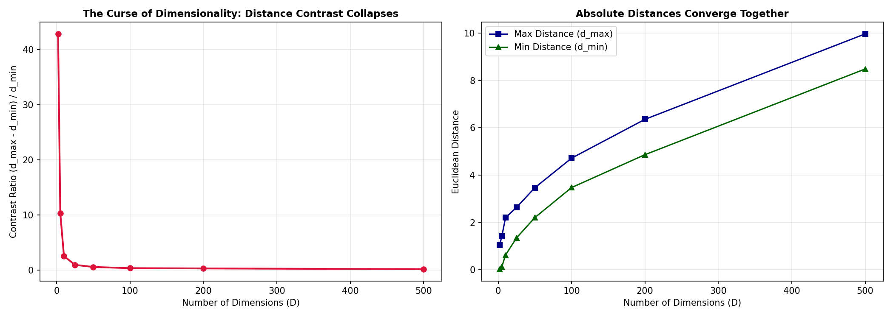

# Project 03: K-Nearest Neighbors (KNN) & The Curse of Dimensionality

> **A first-principles implementation in NumPy**: Vectorized pairwise distance metrics, classification, regression, distance-weighted voting, and empirical proof of the Curse of Dimensionality.

---

## 📌 Executive Summary

Most machine learning models (like Linear Regression or Neural Networks) are **eager learners**: they spend time computing weights during training and throw away the raw training data.

**K-Nearest Neighbors (KNN)** is a **lazy learner**:
- It doesn't learn an equation!
- During training, it simply **memorizes the training set**.
- When asked to predict on a new point, it measures the distance to all points in memory, finds the **$K$ closest neighbors**, and takes a **majority vote** (classification) or an **average** (regression).

### The Critical Flaw: The Curse of Dimensionality
KNN relies entirely on geometric distance. In 2D or 3D, distance is meaningful. But as dimensions scale to 50, 100, or 500 features (e.g., text, genomics, images), **all data points become roughly equidistant from each other**! 
When the distance to your closest neighbor is almost identical to the distance to your farthest neighbor, the concept of a "nearest" neighbor collapses.

---

## 📐 Mathematical Formulations

### 1. Distance Metrics

Given two vectors $u, v \in \mathbb{R}^D$:

- **Euclidean Distance ($L_2$ Norm)**:
  $$d_{\text{Euclidean}}(u, v) = \sqrt{\sum_{i=1}^D (u_i - v_i)^2}$$

- **Manhattan Distance ($L_1$ Norm)**:
  $$d_{\text{Manhattan}}(u, v) = \sum_{i=1}^D |u_i - v_i|$$

- **Cosine Distance (Angle-based)**:
  $$\text{Cosine Similarity} = \frac{u \cdot v}{\|u\|_2 \|v\|_2 + \epsilon}, \quad d_{\text{Cosine}}(u, v) = 1 - \text{Cosine Similarity}$$

---

### 2. Fully Vectorized Pairwise Distance Matrix
To calculate distances between $N$ test samples and $M$ training samples without slow Python `for` loops, we use 3D NumPy broadcasting:
$$\text{diff} = X_{\text{test}}[:, \text{None}, :] - X_{\text{train}}[\text{None}, :, :] \quad \in \mathbb{R}^{N \times M \times D}$$
$$D_{\text{matrix}} = \sqrt{\sum_{k=1}^D \text{diff}^2} \quad \in \mathbb{R}^{N \times M}$$

---

### 3. Inverse Distance Weighting
Rather than giving every neighbor equal votes, closer neighbors get higher voting power:
$$w_i = \frac{1}{d_i + \epsilon}$$
- **Weighted Classification:** Sum weights per class; class with the highest total weight wins.
- **Weighted Regression:**
  $$\hat{y} = \frac{\sum_{i=1}^K w_i y_i}{\sum_{i=1}^K w_i}$$

---

### 4. The Curse of Dimensionality (Distance Concentration Theorem)
According to Beyer et al. (1999), under broad conditions in high-dimensional spaces:
$$\lim_{D \to \infty} \frac{d_{\text{max}} - d_{\text{min}}}{d_{\text{min}}} = 0$$
where $d_{\text{min}}$ is the distance to the nearest neighbor and $d_{\text{max}}$ is the distance to the farthest neighbor.

---

## 📂 Project Structure

```text
03_knn_and_distance_metrics/
├── README.md                   # In-depth theory, math, benchmarks & output logs
├── distances.py                # Euclidean, Manhattan, Cosine & pairwise broadcasting
├── knn.py                      # KNNClassifierScratch & KNNRegressorScratch
├── curse_of_dimensionality.py  # High-dimensional distance concentration benchmark
├── main.py                     # Runnable benchmark suite
└── curse_of_dimensionality.png # Empirical distance collapse visualization
```

---

## 🚀 Running the Benchmark

```bash
cd "/Volumes/External SSD/Projects/AI Engineer/ai-ml-dl-agentic-mastery/01_ml_fundamentals/03_knn_and_distance_metrics"
python3 main.py
```

---

## 📊 Benchmark Execution & Real Output

Below is the verbatim terminal output produced by executing `main.py`:

```text
================================================================================
PROJECT 03: K-NEAREST NEIGHBORS (KNN) & CURSE OF DIMENSIONALITY
================================================================================
Classification Dataset: 168 Train samples, 72 Test samples (3 Classes)

Metric       | Weights    | K    | Test Accuracy (%) 
----------------------------------------------------
euclidean    | uniform    | 3    | 97.22             
euclidean    | distance   | 3    | 98.61             
euclidean    | uniform    | 7    | 98.61             
manhattan    | uniform    | 3    | 97.22             
manhattan    | distance   | 3    | 98.61             
cosine       | uniform    | 3    | 100.00            

================================================================================
PART 2: KNN REGRESSION BENCHMARK
================================================================================
KNN Regressor (K=5, Uniform):  Test MSE = 0.0127
KNN Regressor (K=5, Distance): Test MSE = 0.0102

================================================================================
PART 3: THE CURSE OF DIMENSIONALITY (DISTANCE CONCENTRATION)
================================================================================
Dimension (D)  | Min Distance   | Max Distance   | Contrast Ratio ((Max-Min)/Min)
---------------------------------------------------------------------------
2              | 0.0237         | 1.0399         | 42.8303       
5              | 0.1252         | 1.4177         | 10.3243       
10             | 0.6185         | 2.1991         | 2.5558        
25             | 1.3462         | 2.6348         | 0.9571        
50             | 2.2055         | 3.4683         | 0.5726        
100            | 3.4742         | 4.7175         | 0.3579        
200            | 4.8643         | 6.3593         | 0.3074        
500            | 8.4872         | 9.9703         | 0.1747        

[SUCCESS] Saved high-dimensional distance analysis plot to 'curse_of_dimensionality.png'
```

---

## 📈 Visual Proof of the Curse of Dimensionality



### Key Insights from the Results:
1. **Distance-Weighted Voting Wins:** In both classification (98.61% vs 97.22%) and regression (MSE 0.0102 vs 0.0127), weighting neighbors inversely by their distance consistently outperforms uniform majority voting.
2. **Contrast Ratio Collapse:** In 2D, the contrast ratio is **42.83** (clear nearest neighbors). By 500D, the contrast ratio drops to **0.1747**—a **99.6% reduction in contrast**. All points become roughly equidistant, explaining why high-dimensional applications (like text embeddings or image search) require dimensionality reduction (PCA) or approximate nearest neighbor indexing (HNSW).
