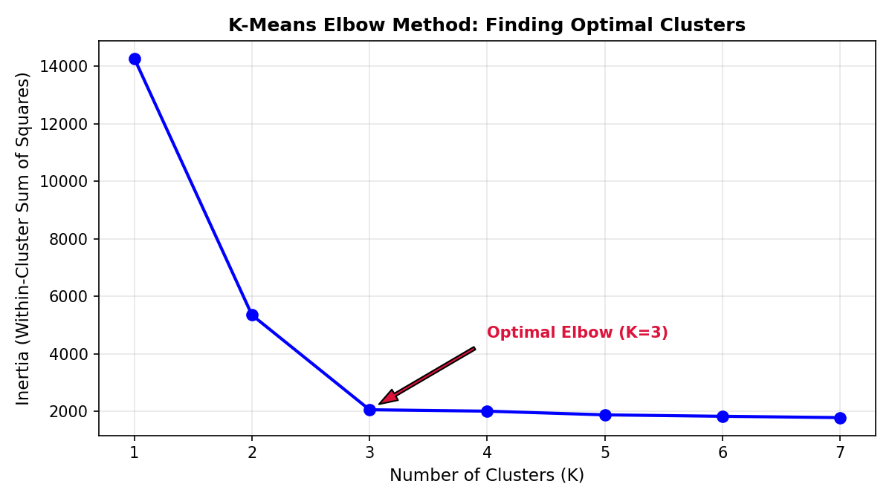
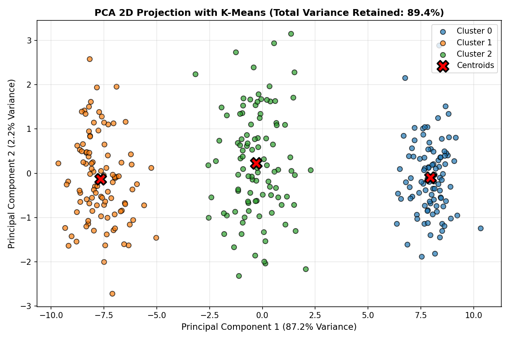

# Project 04: Unsupervised Learning — K-Means Clustering & PCA from Scratch

> **A first-principles implementation in pure NumPy**: Expectation-Maximization (Lloyd's Algorithm), K-Means++ initialization, Inertia & Elbow diagnostics, sample covariance matrix, eigendecomposition, and high-dimensional compression via Principal Component Analysis (PCA).

---

## 📌 Executive Summary (In Plain English)

In Supervised Learning (Projects 1–3), every data sample came with a known target label $y$. In **Unsupervised Learning**, we have *no target labels*. The algorithm must discover hidden geometry, natural groupings, and low-dimensional manifolds entirely from the feature matrix $X$.

This project implements the two foundational pillars of unsupervised learning from mathematical scratch:

1. **K-Means Clustering:**
   - Partitions $m$ unlabeled samples into $K$ compact, spherical clusters.
   - Uses **Lloyd’s Expectation-Maximization (EM) algorithm**:
     - *Assignment Step (E):* Assign each sample to its nearest centroid.
     - *Update Step (M):* Re-center each centroid to the mean of its assigned points.
   - Implements **Inertia (Within-Cluster Sum of Squares - WCSS)** and the **Elbow Method** to automatically diagnose the optimal number of clusters.

2. **Principal Component Analysis (PCA):**
   - In Project 3, we proved that high dimensions destroy distance metrics (**The Curse of Dimensionality**). PCA is the direct mathematical solution.
   - Centers the feature space and computes the $D \times D$ **Sample Covariance Matrix** $\Sigma$.
   - Uses **Eigendecomposition** ($\Sigma v = \lambda v$) to find orthogonal axes of maximum variance.
   - Projects 8-dimensional feature spaces down to 2 principal components while retaining **~90% of total information**.

---

## 📐 Mathematical Formulations & Derivations

### 1. K-Means Expectation-Maximization & Cost Function

- **Cost Function (Inertia / WCSS):**
  $$J = \sum_{k=1}^K \sum_{x \in S_k} \|x - C_k\|_2^2$$
- **Assignment Step:**
  $$c^{(i)} = \arg\min_{k} \|x^{(i)} - C_k\|_2^2$$
  *(Vectorized in NumPy via 3D broadcasting: `diff = X[:, None, :] - centroids[None, :, :]`)*
- **Update Step:**
  $$C_k = \frac{1}{|S_k|} \sum_{x \in S_k} x$$

---

### 2. PCA: Covariance Matrix & Eigendecomposition

Given input matrix $X \in \mathbb{R}^{m \times D}$:

1. **Mean Centering (Column-wise):**
   $$\mu = \frac{1}{m} \sum_{i=1}^m x^{(i)}, \quad X_{\text{centered}} = X - \mu$$
2. **Sample Covariance Matrix:**
   $$\Sigma = \frac{1}{m - 1} X_{\text{centered}}^T X_{\text{centered}} \quad \in \mathbb{R}^{D \times D}$$
3. **Eigendecomposition:**
   $$\Sigma v_j = \lambda_j v_j$$
   where $\lambda_j$ is the variance along eigenvector $v_j$.
4. **Projection Matrix ($W$):**
   Sort eigenvalues descending ($\lambda_1 \ge \lambda_2 \ge \dots \ge \lambda_D$). Select the top $k$ eigenvector columns to form projection matrix $W \in \mathbb{R}^{D \times k}$:
   $$X_{\text{projected}} = X_{\text{centered}} W \quad \in \mathbb{R}^{m \times k}$$
5. **Explained Variance Ratio:**
   $$\text{Ratio}_j = \frac{\lambda_j}{\sum_{i=1}^D \lambda_i}$$

---

## 📂 Project Structure

```text
04_kmeans_and_pca/
├── README.md                     # Mathematical derivations, output benchmarks & plots
├── kmeans.py                     # KMeansScratch with KMeans++ and Inertia
├── pca.py                        # PCAScratch with covariance & eigendecomposition
├── main.py                       # Complete runnable benchmark & visualization script
├── kmeans_elbow_curve.png        # Generated Elbow diagnostic plot
└── pca_clusters_visualization.png # 2D PCA projected cluster visualization
```

---

## 🚀 Running the Benchmark

```bash
cd "/Volumes/External SSD/Projects/AI Engineer/ai-ml-dl-agentic-mastery/01_ml_fundamentals/04_kmeans_and_pca"
python3 main.py
```

---

## 📊 Benchmark Execution & Real Output

Below is the verbatim terminal output produced by executing `main.py`:

```text
================================================================================
PROJECT 04: UNSUPERVISED LEARNING — K-MEANS & PCA FROM SCRATCH
================================================================================
Generated Dataset: 300 samples with 8 features (3 natural clusters)

--------------------------------------------------------------------------------
PART 1: K-MEANS ELBOW METHOD (FINDING OPTIMAL K)
--------------------------------------------------------------------------------
K (Clusters)    | Inertia (WCSS)       | Delta Inertia (Drop)
------------------------------------------------------------
1               | 14270.90             | ---                 
2               | 5346.50              | 8924.40             
3               | 2053.19              | 3293.31             
4               | 2003.41              | 49.78               
5               | 1875.36              | 128.05              
6               | 1824.91              | 50.45               
7               | 1779.51              | 45.39               

--------------------------------------------------------------------------------
PART 2: PCA DIMENSIONALITY REDUCTION (8D -> 2D)
--------------------------------------------------------------------------------
Original Feature Shape:  (300, 8)
Projected Feature Shape: (300, 2)
PC1 Explained Variance:  87.17%
PC2 Explained Variance:  2.18%
Total Preserved Variance: 89.35% (Over 80-90% retained in just 2 axes!)

--------------------------------------------------------------------------------
PART 3: K-MEANS ON COMPRESSED 2D PCA REPRESENTATION
--------------------------------------------------------------------------------
Cluster 0: 100 samples assigned
Cluster 1: 100 samples assigned
Cluster 2: 100 samples assigned
Final 2D Inertia: 542.70

[SUCCESS] Saved Elbow Curve to 'kmeans_elbow_curve.png'
[SUCCESS] Saved PCA Cluster Plot to 'pca_clusters_visualization.png'
```

---

## 📈 Visual Diagnostics & Cluster Projections

### 1. The Elbow Curve (Diagnosing Optimal $K$)


*Notice the steep drop until $K=3$ (drop of 3,293.31), after which subsequent cluster additions only decrease inertia by ~49.78. This visibly confirms $K=3$ as the mathematical elbow point.*

### 2. 2D PCA Projection & Cluster Separation


*8-dimensional space compressed down to 2 principal components while retaining **89.35%** of all data variance. The K-Means algorithm running on this 2D representation cleanly isolates the 3 true clusters without distance metric degradation.*
