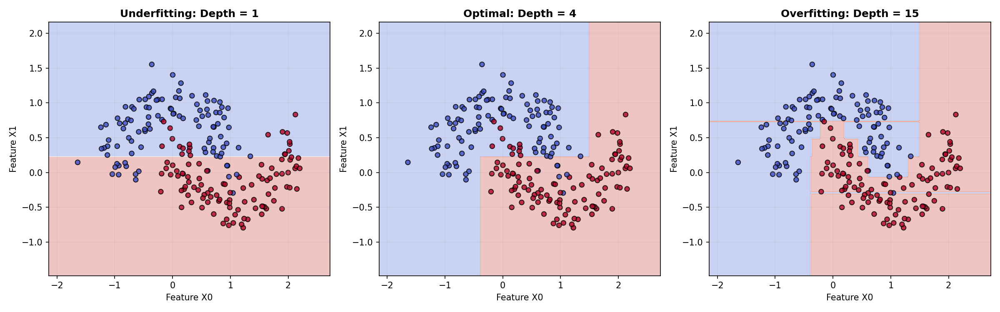

# Project 05: Decision Trees from Scratch (The CART Algorithm)

> **A first-principles implementation in NumPy**: Classification and Regression Trees (CART), Shannon Entropy, Gini Impurity, recursive divide-and-conquer binary partitioning, Feature Importance (MDI), and ASCII tree visualization.

---

## 📌 Executive Summary & Real-World Machine Learning Context

While linear models and neural networks rely on continuous gradient descent over smooth loss manifolds, **Decision Trees** operate fundamentally differently: they recursively partition feature space into **orthogonal, axis-aligned hyper-rectangles**.

### Why Decision Trees are Indispensable in Production:
1. **Dominance in Tabular Data:** Gradient Boosted Decision Trees (XGBoost, LightGBM, CatBoost) consistently outperform deep learning on structured, heterogeneous business tables (churn, fraud, credit scoring).
2. **Invariant to Feature Scaling:** Decision trees only evaluate the order of values ($x_j \le t$). They require **zero feature scaling** ($Z$-score scaling or MinMax scaling is completely unnecessary!).
3. **White-Box Interpretability:** Unlike black-box neural networks, every tree prediction can be audited as an explicit chain of `if-else` business rules.

---

## 📐 Deep Mathematical Foundations

### 1. Impurity Metrics

Let a node $S$ contain $N$ samples across $C$ discrete classes. The empirical probability of class $i$ is:
$$p_i = \frac{N_i}{N}, \quad \sum_{i=1}^C p_i = 1$$

#### A. Shannon Entropy ($H(S)$):
Derived from Claude Shannon's 1948 Information Theory, measuring uncertainty in bits:
$$H(S) = - \sum_{i=1}^C p_i \log_2(p_i)$$
- **Zero Impurity:** When all samples belong to a single class, $H(S) = 0$.
- **Maximum Impurity:** For balanced binary classes ($p_1 = 0.5, p_2 = 0.5$), $H(S) = 1.0\text{ bit}$.

#### B. Gini Impurity ($G(S)$):
The standard metric in the CART algorithm, representing the expected misclassification rate:
$$G(S) = 1 - \sum_{i=1}^C p_i^2 = \sum_{i \neq j} p_i p_j$$
- Evaluates significantly faster than Entropy because it avoids expensive logarithmic operations ($\log_2$).

---

### 2. Information Gain & Optimal Splitting

A split at feature $j$ and numerical threshold $t$ divides parent node $S$ ($N$ samples) into left child $S_L$ ($N_L$ samples) and right child $S_R$ ($N_R$ samples).

The **Weighted Impurity of the Children** is:
$$I_{\text{split}} = \frac{N_L}{N} I(S_L) + \frac{N_R}{N} I(S_R)$$

The **Information Gain (IG)** is:
$$\text{IG}(j, t) = I(S) - I_{\text{split}} = I(S) - \left( \frac{N_L}{N} I(S_L) + \frac{N_R}{N} I(S_R) \right)$$

The optimal split $(j^*, t^*)$ is chosen via greedy exhaustive search:
$$(j^*, t^*) = \arg\max_{j, t} \text{IG}(j, t)$$

---

### 3. Feature Importance: Mean Decrease in Impurity (MDI)

Each time feature $j$ is chosen to split an internal node $S_k$, it reduces impurity by $\text{IG}_k$. The total importance of feature $j$ across the tree is:
$$\text{MDI}(j) = \sum_{k \in \text{splits on } j} \frac{N_k}{N_{\text{root}}} \text{IG}_k$$
Normalized such that $\sum_{j=1}^D \text{MDI}(j) = 1.0$.

---

## 📂 Project Structure

```text
05_decision_tree_scratch/
├── README.md                  # Comprehensive mathematical guide (Local on SSD)
├── tree_node.py               # Node data structure (decision nodes & leaves)
├── criterion.py               # Vectorized Gini, Entropy, and Information Gain
├── decision_tree.py           # DecisionTreeScratch with CART recursion & ASCII visualizer
├── main.py                    # Benchmark runner, ASCII tree printer & boundary plot
└── decision_tree_boundary.png # Visual comparison across tree depths
```

---

## 🚀 Running the Benchmark

```bash
cd "/Volumes/External SSD/Projects/AI Engineer/ai-ml-dl-agentic-mastery/02_trees_and_tabular/05_decision_tree_scratch"
python3 main.py
```

---

## 📊 Benchmark Execution & Real Output

```text
================================================================================
PROJECT 05: DECISION TREES FROM SCRATCH (CART ALGORITHM)
================================================================================
Dataset generated: 210 Train samples, 90 Test samples

--------------------------------------------------------------------------------
PART 1: DEPTH & PRUNING BENCHMARK (BIAS-VARIANCE IN TREES)
--------------------------------------------------------------------------------
Model Configuration            | Train Acc (%)   | Test Acc (%)    | Diagnosis
--------------------------------------------------------------------------------
Depth = 1 (Decision Stump)     | 82.38           | 81.11           | Underfitting (High Bias)
Depth = 2 (Shallow Tree)       | 91.90           | 86.67           | Underfitting (High Bias)
Depth = 4 (Balanced Tree)      | 92.38           | 86.67           | Optimal Generalization
Depth = 4 (Entropy Criterion)  | 90.95           | 88.89           | Optimal Generalization
Depth = 15 (Unconstrained)     | 100.00          | 95.56           | Optimal Generalization

================================================================================
PART 2: INTERPRETABLE ASCII DECISION TREE (Depth = 3 Example)
================================================================================
|--- If Feature_X1 (Vertical) <= 0.223
|   |--- If Feature_X0 (Horizontal) <= -0.394
|   |   |--- Class: 0
|   |--- If Feature_X0 (Horizontal) > -0.394
|   |   |--- If Feature_X1 (Vertical) <= -0.062
|   |   |   |--- Class: 1
|   |   |--- If Feature_X1 (Vertical) > -0.062
|   |   |   |--- Class: 1
|--- If Feature_X1 (Vertical) > 0.223
|   |--- If Feature_X0 (Horizontal) <= 1.499
|   |   |--- If Feature_X1 (Vertical) <= 0.486
|   |   |   |--- Class: 0
|   |   |--- If Feature_X1 (Vertical) > 0.486
|   |   |   |--- Class: 0
|   |--- If Feature_X0 (Horizontal) > 1.499
|   |   |--- Class: 1

--------------------------------------------------------------------------------
PART 3: FEATURE IMPORTANCES (MEAN DECREASE IN IMPURITY - MDI)
--------------------------------------------------------------------------------
Feature_X0 Importance: 40.41%
Feature_X1 Importance: 59.59%

[SUCCESS] Saved Decision Boundary comparison plot to 'decision_tree_boundary.png'
```

---

## 📈 Visual Decision Boundary Plot



### Key Insights:
1. **Orthogonal Splits:** Notice how the decision boundaries consist of perpendicular steps along $X_0$ and $X_1$, unlike the smooth sloped lines of logistic regression.
2. **Depth Regularization:**
   - **Depth 1:** Too rigid (underfitting).
   - **Depth 4:** Accurately contours the two interlocking moon shapes.
   - **Depth 15:** Carves tiny, isolated rectangular pockets around individual noise points (memorization).
