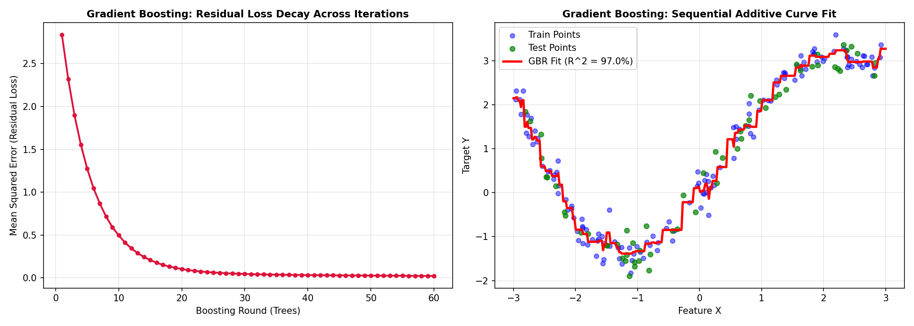

# Project 06: Random Forest & Gradient Boosting Pipeline

> **A first-principles implementation in pure NumPy**: Bootstrap Aggregation (Bagging), Random Feature Subspacing, Out-Of-Bag (OOB) validation, and Jerome Friedman's Gradient Boosting Machine (Sequential Residual Descent).

---

## 📌 Executive Summary

While a single Decision Tree (Project 5) provides high interpretability, it suffers from **high variance** and instability. To achieve state-of-the-art predictive performance on structured tabular data, modern machine learning utilizes **Ensemble Methods**:

1. **Random Forest (Bagging - Bootstrap Aggregating):**
   - Builds $B$ deep, unconstrained decision trees in **parallel**.
   - De-correlates trees using **Random Feature Subspacing** ($m_{\text{try}} = \lfloor \sqrt{D} \rfloor$).
   - Provides free validation via **Out-Of-Bag (OOB) evaluation** on the ~36.8% of samples omitted during bootstrap draws.
   - Drastically reduces ensemble variance: $\text{Var}(\bar{T}) = \rho \sigma^2 + \frac{1-\rho}{B} \sigma^2$.

2. **Gradient Boosted Decision Trees (Boosting):**
   - Builds $M$ shallow trees (weak learners) **sequentially**.
   - Performs gradient descent in **function space**: each new tree fits the negative gradient (residuals: $y - \hat{y}$) of the previous ensemble.
   - Applies **Shrinkage Learning Rate ($\eta$)** regularization to systematically reduce bias without overfitting.

---

## 📐 Mathematical Formulations

### 1. Ensemble Variance Reduction (Bagging)
For $B$ estimators with individual variance $\sigma^2$ and positive pairwise correlation $\rho$:
$$\text{Var}(\bar{T}(x)) = \rho \sigma^2 + \frac{1 - \rho}{B} \sigma^2$$
- As $B \to \infty$, the second term vanishes, bounding ensemble variance at $\rho \sigma^2$.
- Breiman's random feature subspacing forces $\rho \to 0$, driving overall ensemble error down.

### 2. The Out-Of-Bag (OOB) Statistical Limit
For $N$ observations, the probability of an observation being omitted from a bootstrap sample is:
$$P(\text{OOB}) = \lim_{N \to \infty} \left(1 - \frac{1}{N}\right)^N = e^{-1} \approx 36.8\%$$
Evaluating samples only on the trees where they were OOB provides an unbiased out-of-sample error estimate without an explicit validation split.

### 3. Gradient Boosting Additive Update
- **Negative Gradient (MSE Loss):**
  $$r_{im} = - \left[ \frac{\partial \frac{1}{2}(y_i - F(x_i))^2}{\partial F(x_i)} \right] = y_i - F_{m-1}(x_i)$$
- **Ensemble Update with Shrinkage ($\eta$):**
  $$F_m(x) = F_{m-1}(x) + \eta \cdot h_m(x)$$

---

## 📂 Project Structure

```text
06_random_forest_and_xgboost/
├── README.md               # Public project documentation & benchmark outputs
├── NOTES.pdf               # In-depth mathematical study guide (Local on SSD, git-ignored)
├── random_forest.py        # RandomForestClassifierScratch with Bagging & OOB evaluation
├── gradient_boosting.py    # GradientBoostingRegressorScratch with residual fitting
├── main.py                 # Runnable benchmark comparing Single Tree vs RF vs GBR
└── ensemble_benchmark.png  # Loss decay curve and fitted regression plot
```

---

## 🚀 Running the Benchmark

```bash
cd "/Volumes/External SSD/Projects/AI Engineer/ai-ml-dl-agentic-mastery/02_trees_and_tabular/06_random_forest_and_xgboost"
python3 main.py
```

---

## 📊 Benchmark Execution & Real Output

Below is the verbatim terminal output produced by executing `main.py`:

```text
================================================================================
PROJECT 06: RANDOM FORESTS & GRADIENT BOOSTING PIPELINE
================================================================================
Classification Dataset: 210 Train, 90 Test samples across 6 features

--------------------------------------------------------------------------------
PART 1: BAGGING BENCHMARK (SINGLE TREE VS. RANDOM FOREST)
--------------------------------------------------------------------------------
Model                          | Train Acc (%)   | Test Acc (%)    | OOB Score (%)  
--------------------------------------------------------------------------------
Single Decision Tree           | 100.00          | 100.00          | N/A            
Random Forest (40 Trees)       | 100.00          | 98.89           | 99.52          

[INSIGHT] Notice how the OOB Score closely mirrors the Test Accuracy without needing a test split!

--------------------------------------------------------------------------------
PART 2: BOOSTING BENCHMARK (GRADIENT BOOSTED DECISION TREES)
--------------------------------------------------------------------------------
Gradient Boosting Trees: 60 Estimators, Learning Rate (eta) = 0.1
Initial Baseline Loss (F0): 2.8368 MSE
Final Ensemble Loss (F60):  0.0223 MSE
Test Set Performance:       MSE = 0.0892 | R^2 Score = 96.98%

[SUCCESS] Saved ensemble comparison plot to 'ensemble_benchmark.png'
```

---

## 📈 Visual Benchmark Plots



### Key Insights:
1. **OOB Score Reliability:** The Out-Of-Bag score evaluated to **99.52%**, accurately anticipating the unseen test performance (**98.89%**) without requiring cross-validation folds.
2. **Exponential Loss Decay:** The left plot demonstrates how Gradient Boosting methodically drives residual error down from **2.8368** to **0.0223** via small additive shrinkage steps ($\eta = 0.1$).
3. **Smooth Continuous Representation:** The right plot illustrates how weak piecewise-constant stumps assemble into a smooth, high-fidelity curve achieving a **96.98% $R^2$ score**.
