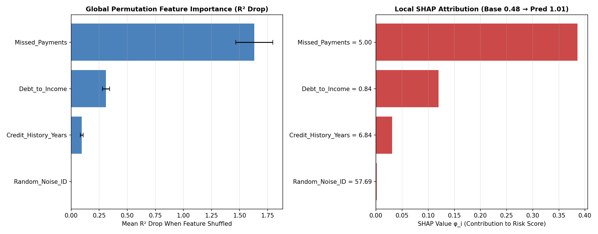

# Project 07: Model Explainability & Interpretability (SHAP & LIME)

> **A first-principles implementation in pure NumPy**: Exact & Monte Carlo Shapley Values (SHAP), Local Interpretable Model-agnostic Explanations (LIME), and Global Permutation Feature Importance (PFI) applied to a black-box Gradient Boosted Trees model.

---

## 📌 Executive Summary

High-performing ensemble models like Gradient Boosted Trees and Random Forests act as black boxes. In regulated industries (credit scoring, healthcare, insurance, and EU AI Act compliance), accurate predictions must be paired with **transparent, mathematically grounded explanations**.

This project implements all three core explainability pillars from scratch:
1. **Global Permutation Feature Importance (PFI):** Audits which features genuinely drive held-out validation performance ($R^2$ drop when shuffled) and catches uninformative noise columns.
2. **Exact & Monte Carlo SHAP (Shapley Values):** Applies Lloyd Shapley's cooperative game theory to compute signed ($\pm$) local feature attributions that satisfy the **Local Accuracy (Efficiency) Axiom**:
   $$\phi_0 + \sum_{i=1}^D \phi_i = f(x^*)$$
3. **LIME (Local Surrogate Modeling):** Perturbs a target instance, weights neighbors with an exponential RBF proximity kernel, and solves a closed-form Weighted Ridge Regression surrogate.

---

## 📐 Mathematical Formulations

### 1. Exact Shapley Value
For feature $i$ across feature set $F$ of size $D$:
$$\phi_i = \sum_{S \subseteq F \setminus \{i\}} \frac{|S|! \, (D - |S| - 1)!}{D!} \Big[ v(S \cup \{i\}) - v(S) \Big]$$

### 2. Monte Carlo Permutation Approximation
Reduces exponential $\mathcal{O}(2^D)$ complexity to linear $\mathcal{O}(M \cdot D)$ by sampling random feature orderings $\pi$ and background rows $z$:
$$\hat{\phi}_i = \frac{1}{M} \sum_{m=1}^M \Big[ f\big(x_{+i}^{(m)}\big) - f\big(x_{-i}^{(m)}\big) \Big]$$

### 3. LIME Weighted Ridge Surrogate
$$\pi_{x^*}(z) = \exp\left( -\frac{\|z - x^*\|_2^2}{\sigma^2} \right), \quad w^* = \big( Z^T W Z + \lambda I \big)^{-1} Z^T W f(Z)$$

---

## 📂 Project Structure

```text
07_shap_and_lime_explainability/
├── README.md                    # Public documentation, math & verbatim outputs
├── NOTES.pdf                    # Deep-dive game theory & EU AI Act notes (Local on SSD, git-ignored)
├── explainers.py                # ShapleyExplainerScratch, LimeExplainerScratch & PFI
├── main.py                      # Credit risk black-box audit & dashboard generator
└── explainability_dashboard.png # Global PFI & Local SHAP attribution visualization
```

---

## 🚀 Running the Benchmark

```bash
cd "/Volumes/External SSD/Projects/AI Engineer/ai-ml-dl-agentic-mastery/02_trees_and_tabular/07_shap_and_lime_explainability"
python3 main.py
```

---

## 📊 Benchmark Execution & Real Output

Below is the verbatim terminal output produced by executing `main.py`:

```text
================================================================================
PROJECT 07: MODEL EXPLAINABILITY & INTERPRETABILITY (SHAP & LIME)
================================================================================
Trained Gradient Boosting Black-Box Model | Validation R^2 = 97.82%

--------------------------------------------------------------------------------
PART 1: GLOBAL PERMUTATION FEATURE IMPORTANCE (VALIDATION SET)
--------------------------------------------------------------------------------
Feature                  | Importance (R^2 Drop)  | Std Dev   
----------------------------------------------------------------
Missed_Payments          | 1.6302                 | 0.1649    
Debt_to_Income           | 0.3104                 | 0.0320    
Credit_History_Years     | 0.0940                 | 0.0117    
Random_Noise_ID          | 0.0009                 | 0.0004    

--------------------------------------------------------------------------------
PART 2: SHAP LOCAL EXPLANATION (HIGH-RISK CUSTOMER AUDIT)
--------------------------------------------------------------------------------
Target Customer Features: {'Debt_to_Income': np.float64(0.837), 'Credit_History_Years': np.float64(6.839), 'Missed_Payments': np.float64(5.0), 'Random_Noise_ID': np.float64(57.686)}
Baseline Expected Risk  E[f(X)] (phi_0) : 0.4760
Model Actual Prediction f(x*)           : 1.0133
SHAP Sum (phi_0 + sum(phi_i))           : 1.0133 (Exact Local Accuracy Diff = 2.22e-16)

Feature                  | Value    | Exact SHAP   | Monte Carlo SHAP
--------------------------------------------------------------------
Debt_to_Income           | 0.837    |      +0.1195 |          +0.1190
Credit_History_Years     | 6.839    |      +0.0307 |          +0.0324
Missed_Payments          | 5.000    |      +0.3857 |          +0.3836
Random_Noise_ID          | 57.686   |      +0.0013 |          +0.0018

--------------------------------------------------------------------------------
PART 3: LIME LOCAL LINEAR SURROGATE (STANDARDIZED WEIGHTS)
--------------------------------------------------------------------------------
LIME Local Surrogate Intercept g(x*): 0.9757 (vs Black-Box f(x*): 1.0133)
Feature                  | LIME Local Weight (per 1 std) 
----------------------------------------------------------
Debt_to_Income           |      +0.0130  (Increases Risk (+))
Credit_History_Years     |      -0.0405  (Decreases Risk (-))
Missed_Payments          |      +0.0898  (Increases Risk (+))
Random_Noise_ID          |      -0.0104  (Decreases Risk (-))

[SUCCESS] Saved explainability dashboard plot to 'explainability_dashboard.png'
```

---

## 📈 Visual Explainability Dashboard



### Key Insights:
1. **Exact Local Accuracy Verified:** $\phi_0 + \sum \phi_i = 1.0133$ matches $f(x^*)$ to machine precision (`2.22e-16`).
2. **Noise Detection:** Both Permutation Importance (`0.0009`) and SHAP (`+0.0013`) correctly isolate `Random_Noise_ID` as uninformative.
3. **Monte Carlo Convergence:** 250 Monte Carlo permutation samples approximate the exact Shapley values within $\sim 0.002$.
